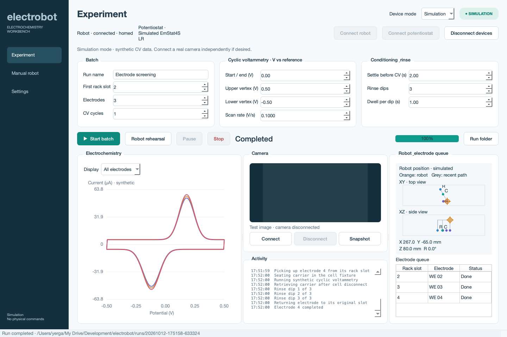

# Electrobot

Source repository: [aalto-ema/electrobot on GitHub](https://github.com/aalto-ema/electrobot). The project migrated from Aalto GitLab with its Git history preserved.

Licensed under the [MIT License](LICENSE).

PySide6 desktop workbench for a Dobot Magician Lite + MagicBox and PalmSens EmStat4S LR electrochemistry platform. Choose **Simulation** for development on macOS or **Hardware** for lab commissioning. The real drivers target `dobotkit 0.2.0` and `pypalmsens 2.2.0`. Automated checks use device doubles; robot rehearsal has begun in the lab, with reach-limit stopping under investigation. Full robot/potentiostat commissioning is incomplete.



## Install and start

Python 3.11–3.14. From the project folder:

On a new computer, first download the repository:

```sh
git clone https://github.com/aalto-ema/electrobot.git
cd electrobot
```

Then install and start:

```sh
python -m venv .venv
# macOS
source .venv/bin/activate
# Windows PowerShell: .venv\Scripts\Activate.ps1
python -m pip install -r requirements.txt
python run_app.py
```

Double-click **Start Electrobot.command** on macOS or **Start Electrobot.bat** on Windows after setup. The launchers use `.venv` automatically. Simulation does not import the hardware SDKs or require .NET.

For hardware, additionally install:

```sh
python -m pip install -r requirements-hardware.txt
```

On the Windows lab computer:

- Install the **.NET Desktop Runtime 10.0** matching your Python architecture. The packaged PalmSens Windows runtime configuration requires both `Microsoft.NETCore.App` and `Microsoft.WindowsDesktop.App` 10.0.
- Install the PalmSens USB drivers; PSTrace normally supplies these. Close PSTrace before connecting from Electrobot.
- Start **DobotLink**. `dobotkit` talks to its WebSocket service (default `localhost:9090`); DobotLink relays commands over USB/COM to the arm. Set the correct arm COM port in Settings, or use `auto` when exactly one Dobot is available.
- Connect the camera and allow OS camera access. Windows capture uses DirectShow; macOS uses the default OpenCV backend.

## Experiment workspace

Live robot tracking appears above the electrode queue on Experiment and beside the controls on Manual robot. Orange markers show current tool position in XY and XZ views; grey lines show recent reported motion, and C/R mark cell/rinse. The diagrams auto-fit the stations and recent positions. XYZ/R values distinguish hardware feedback from simulated positions. Calibration and Workspace diagrams also show the current pose. Hardware moves publish pose feedback during queue execution (about 10 Hz subject to RPC latency), with idle polling every 0.5 s. Simulation interpolates positions. Missing idle feedback or disconnect clears the marker. Tracking reflects reported tool pose, not a camera-verified electrode position or a collision check.

**Robot rehearsal** runs the same pickup → seat/release in cell → retrieve → rinse → return sequence without CV or a required potentiostat connection. It actively opens/closes the gripper, so it can be used with an empty rack for a movement check or with dummy carriers to test handling. Use one electrode initially. The configured settling time is the brief stand-in wait at the cell; CV duration is omitted. Rinse settings and robot speed still apply. Hardware requires connection, explicit homing and verified calibration/fixture flags just like a batch. Stop remains available. The rehearsal follows the current release-in-cell workflow, not the future hold-during-CV design.

For a robot-only rehearsal, disconnect the WE lead from an independently controlled potentiostat. An app-connected potentiostat is commanded cell-off before movement and during cleanup, but is never asked to measure. Rehearsals save settings, events and a summary marked `robot_rehearsal`; they create no electrochemistry CSV or synthetic CV data.

The main page includes batch name, first rack slot, number of electrodes, CV cycle count, start/end and vertex potentials, scan rate, settling time, and rinse settings. It also contains device connection status, start/stop controls, per-electrode progress, a CV plot, a compact camera preview with snapshots, and the activity log. The right column starts alongside the experiment settings and contains the taller live robot view and electrode queue. The lower-left area holds the CV plot and camera/activity in resizable columns. Drag the dividers to adjust their widths.

The camera is independent of robot/potentiostat mode: a real camera can be used during a simulated batch. No pickup detection or camera-based recovery is implemented yet.

The plot overlays electrodes or shows a selected electrode. Displayed points are decimated for long batches so the UI remains responsive; CSV exports retain every received sample. Pause/resume is available in simulation. Hardware pause is disabled because interrupting a CV sweep would change the experiment; use Stop to abort.

Native PalmSens CV returns to its start potential, so the UI has a combined **Start / end** setting. The simulator follows that same protocol. The reference label, potential step, fixed current range, mains frequency and simulation multiplier live under Settings → Measurement defaults.

## Manual robot

Use **Manual robot** to read the reported pose, home, jog XYZ/R, move to an absolute target, and release/close/fully open the gripper. Commands run in the same serialized worker as experiments, so batch and manual operations cannot compete for a device. Operations and mode changes are disabled during an active command.

Hardware connection does not home, move, or actuate the gripper. Homing is explicit and required before hardware motion. Moves use `MOVL_XYZ`, wait for queued-command completion, and then verify reported XYZ/R against the configured tolerance. Timeouts, cancellation and pose mismatch stop and clear the queue. Rehome before subsequent hardware movement after a stop.

**Teach station** copies the reported pose into rack slot 1, cell seating, rinse dipping, or travel height settings. Teaching and changes to station/workspace coordinates clear the calibration flag. Save the configuration after verifying the route. Gripper state is the *commanded* state, not confirmation of a successful pickup.

### Reach limits and fault feedback

The arm's reachable XY area depends on Z and its joint configuration. A point inside the entered XYZ bounds and radial band is not necessarily reachable. Before a hardware experiment/rehearsal, Electrobot now asks the controller's **CheckPoseLimit** command about the planned handling route without moving: the initial lift, rack/cell/rinse approach heights, transfers at Travel Z, and intermediate straight-line samples. Manual moves receive the same sampled check. The default spatial spacing is 10 mm, with extra angular and closest-radius samples; this is not continuous-path or obstacle/collision validation.

To test your configuration separately, connect and home, then use **Manual robot → Check planned route · no motion**, or **Settings → Workspace → Check planned route · no movement**. The route check is cancellable between controller calls and can take time for many electrodes. Changing settings makes the old result stale; hardware runs always preflight again. If the firmware cannot answer this command, the UI reports it and blocks enabled preflight. **Settings → Workspace → Controller reachability and fault detection** allows explicit disabling of the controller check, adjustment of sample spacing and adjustment of the no-progress timeout; disabling it reduces protection and leaves the entered bounds plus runtime diagnostics. No software IK model or theoretical reach envelope is silently substituted.

During movement, the worker polls controller alarms and reported pose. If the robot reports an alarm or an unfinished move makes no reported progress for **5 s** by default, the software stops/clears its queue, preserves the gripper command, and requires homing before further motion. A stall is labelled a possible limit/obstruction/controller problem, not a confirmed mechanical diagnosis. Missing alarm feedback is displayed as unavailable; the progress watchdog and overall motion timeout remain. Software response still depends on RPC latency and is not an emergency-stop mechanism.

Both **Experiment** and **Manual robot** retain the requested target and actual reported XYZ, plus a visible fault banner. **Robot diagnostic details… / Diagnostic details…** opens the full report, including R/joint angles when reported, numeric alarm IDs, raw alarm response, rejected preflight sample and a **Copy diagnostic report** button. Fault messages also appear in Activity; hardware runs save `robot-diagnostics.json` alongside events and summary. Manual faults without a run folder can be copied from the dialog.

For recovery, inspect the robot and route first. **Manual robot → Clear controller alarms** explicitly stops/clears the queue and sends the alarm-clear command, without moving or releasing the gripper. It does not rehome or resume. Then home using the verified homing path and recheck the corrected route. A rejected non-moving check can be corrected and checked again without automatic recovery motion. The new controller queries/alarm handling are tested with mocks; support and interpretation must still be checked against the lab firmware.

## Settings and lab commissioning

Settings groups persistent design and calibration parameters into Devices, Measurement defaults, Robot calibration, Workspace, Cell & carrier, and Rack design tabs. Configurations save to `settings.json` and can be loaded from JSON. Profiles never connect hardware or change the selected mode automatically; every app session starts in Simulation.

Robot calibration includes **Compact rehearsal from current pose**. With an idle connected robot (homed in hardware mode and commanded open), this reads a fresh pose without motion and anchors rack slot 1 to it. Cell is +10 mm X, rinse is +10 mm X/+10 mm Y, and travel Z is +5 mm; tool R is preserved. It selects one electrode, one 0.5 s rinse dip, 1 s settling and velocity/acceleration settings of 10. Calibration and fixture readiness are cleared. An incompatible preset is rejected without changing any settings; move manually to a verified clear intermediate pose and try again. Use only with an empty gripper initially.

Robot calibration and Workspace use the same top/side diagram, including X/Y/Z bounds, radial limits and the live robot position. These diagrams explain rack coordinates and slot ordering, pitch, station approach heights, travel Z, vertical-axis rotation and the intersection of Cartesian bounds with the radial band. Rack columns and rows through the last selected slot update dynamically; filled dots mark selected electrodes. Rack, cell and rinse XY points, station Z heights, travel height, workspace rectangle and radial band are plotted from actual coordinates. Equal XY scaling preserves relative distances; station columns in the side view are categorical. Labels and points update as settings change. The diagrams do not model collisions. Tooltips and motion notes explain tolerances, timeouts and dwell settings. Both tabs show live incompatibility messages and highlight related fields. Checks cover height ordering, rack pitch, inverted bounds and all selected station/transfer endpoints, in simulation as well as hardware. Invalid settings disable experiment and rehearsal starts. Passing these checks does not establish physical clearance.

A suggested first lab session:

1. Select Hardware, set the Dobot COM port and PalmSens device ID if more than one instrument is present, and connect the robot. Connect the potentiostat independently. An ambiguous discovery result is an error; the app does not silently pick a device or fall back to simulation.
2. Clear the homing path and use Manual robot → Home. Test the gripper unloaded. Normal release uses `arm.effector.grip(False, enable=False, queued=False)` so the pump is off and the fingers relax to their intermediate opening. Closing uses `grip(True, enable=True, queued=False)`. Manual robot also provides **Fully open · pump on**, using `grip(False, enable=True, queued=False)` for the powered opening limit. Experiments and rehearsals always use pump-off release. Check clearance and successful release with your installed gripper; displayed states are commanded, not measured finger positions.
3. Jog in small increments and teach rack slot 1, cell and rinse poses. Configure rack spacing/columns, tool rotation, travel height, and endpoint workspace bounds. Validate all straight-line approaches and clearance transfers, including the initial lift from the current pose.
4. Verify carrier seating, immersion, release/retrieval, gripper clearance and dry WE electrical contact. Mark **Station poses and paths calibrated** and **Gripper, seating and dry contact verified**. Geometry changes clear the fixture flag.
5. Connect the potentiostat, select a chemistry-appropriate CV protocol and current range, and start with one electrode. The device validates the method before any batch movement.

A hardware batch turns the cell off before handling the electrode, lifts vertically at the current station before transferring at travel height, inserts/releases the carrier, waits for settling, runs CV, turns the cell off, retrieves, dips in the rinse beaker, and returns to the exact original rack slot. If measurement or movement fails, it stops and records the failure; it does not automatically attempt recovery.

**Stop is a software command, not a physical emergency stop.** Robot stopping is limited by the DobotLink RPC response time and controller behaviour. Workspace limits constrain endpoints; they do not model obstacles, joint limits or collision-free paths. Use the hardware emergency-stop facility when needed. The defaults are simulation placeholders and must be calibrated.

The pneumatic gripper pump is turned off by device disconnection. After a stop, secure any held electrode and open the gripper before disconnecting or closing. The UI blocks disconnect/close while the hardware gripper is commanded closed; closing during a hardware operation first requests a stop and leaves the app available for recovery.

## Data and failure records

Every batch creates a unique folder under `runs/` with the configuration snapshot, `events.json`, `summary.json`, and per-electrode CSVs. Hardware acquisition also saves the SDK JSON Lines stream. CSV current is normalized to µA and potential to V; unsupported units fail the measurement rather than being mislabelled. CSV time is **nominal CV sample time** (`step / scan_rate`), since CV callbacks provide E/I rather than measured timestamps; `time_source` makes this explicit. Simulation uses protocol timestamps. `synthetic` identifies simulated versus measured values.

CSV rows are flushed as they arrive. Partial measurements survive cancellation and are marked stopped/failed. Failed cell-off or robot-stop cleanup is recorded explicitly. No retrieval or rinse proceeds after measurement failure. Summary grip state represents commands, not detected electrode presence.

## Initial defaults and cap concept

- Three electrodes, five-column rack, 22 mm pitch.
- Rod Ø6 × 100 mm, Ø12 mm carrier shoulder, tip 50 mm below shoulder.
- Nominal 100 mL low-form beaker: Ø50 × 70 mm; assumed rim Ø53 mm **must be measured**.
- Cap: 4 mm plate, 6 mm outer skirt, 3 mm wall, 0.8 mm diametral rim clearance.
- WE bore Ø6.6 mm, Ø10 mm / 2 mm deep conical guide; RE Ø8 and CE Ø6 openings at ±14 mm.
- Target immersion 15 mm requires liquid 35 mm below the shoulder (31 mm below plate underside). Volume alone does not fix immersion.
- CV: 0 → +0.5 → −0.5 → +0.5 → −0.5 → 0 V, two cycles, 100 mV/s, 5 mV step, 100 µA range; 2 s settling; three rinse dips at 1 s per dip. These are simulation examples, not a validated electrochemical method.

`cad/cell_cap.stl` is a closed solid in mm; `cad/cell_cap.scad` is editable OpenSCAD. Export updated geometry from Settings → Cell & carrier or run `python -m electrobot.cad`. `cad/cap_sketch.svg` shows the concept.

The cap has a surrounding locating skirt and open spout notch/vent. The carrier shoulder rests on the plate; the tapered opening guides the WE. RE/CE openings need separate compatible collars/clamps. The cap model does not include electrical contacts or gripper parts. Measure glassware and electrode lengths before printing. Print flat upper face on the bed, skirt upward. Choose materials for the actual electrolyte and temperature; FDM parts can contaminate sensitive measurements. Keep the cap vented and fix the beaker externally.

Provisional pickup-collar and three-finger probe-bracket STLs are in [`cad/gripper`](cad/gripper/README.md), with editable JSON dimensions and a Python generator. Their mounting geometry has not been fitted to the physical gripper. The measurement checklist, print notes and separate metal components are documented there. The provisional 24 mm flange also requires a larger rack pitch than the current 22 mm default. This design requires a hold-during-CV sequence, which is not yet implemented.

## Placement guide and printable racks

Settings → **Export placement PDF** creates an A4 landscape overview, a complete station/slot coordinate checklist, and tiled **1:1 placement templates**. Print at 100% / Actual size and verify each 50 mm scale line. Trim at tile frames and assemble with tile row increasing along +Y. The guide marks the robot's XY datum and directions, not an unmeasured physical base footprint. Beaker outlines use the entered cell and rinse diameters and assume the cell WE axis is central. Z values are robot tool positions, not heights inferred from the printed rack or bench. Physical clearances and actual tool offsets still require calibration. Export uses Qt's PDF writer, so there is no additional Python dependency.

Settings → Robot calibration → **Rack layout** selects rectangular or radial geometry. In radial mode, First row radius and Slot 1 angle are measured about the robot XY origin; positive angles turn from +X toward +Y. Columns means slots per arc row, Angle between slots gives angular spacing, and Slot pitch gives the radial spacing between rows. First-slot X/Y are ignored. Teaching the first rack slot updates radius/angle/Z in radial mode. The compact rehearsal preset returns to rectangular layout. Slot mapping is shared by movement, diagrams, PDF and CAD. Calibration checks include socket/carrier separation; a full row spanning 360 degrees is rejected. Radial racks do not imply collision-free transfers between slots.

Settings → **Rack design** contains the printing settings and a live holder-seat/top-view schematic that stays visible while the fields scroll. Existing profiles retain the legacy blind-socket design. **Use lattice and allow holder spacing** selects the optimized design and widens pitch/angular spacing if necessary, without commanding movement; calibration and fixture readiness are cleared. The lattice supports the pickup holder bottom in a shallow recess, leaving the body, upper flange and contact accessible while the rod hangs through a clearance opening. Adjust holder body/flange, rod insertion, contact/wire openings, locating clearance/depth, ribs, hanging length, tip clearance, foot columns/pegs and printer dimensions here. Rod diameter/length remain shared with Cell & carrier. Hanging length must cover rod length minus insertion, including any additional active-tip projection; the defaults are 100 − 13 = 87 mm and 10 mm tip clearance. Cell cap and probe-bracket compatibility still need separate confirmation.

**Export rack printing files** creates separate STL files for top modules, reusable fork feet, pickup holders and an optional single-seat fit coupon, plus `ASSEMBLY.md` and a manifest with print quantities, part dimensions, geometry IDs, assembly origins and rotations. Complete rows through the last selected slot are exported, including inactive end-of-row slots. Each top contains up to the configured number of seats; identical rotated shapes share one file with a quantity. Exports reject parts larger than the configured printer XY area: reduce slots per module if necessary. Printer Z capacity and slicer/support choices still need checking. Feet use removable paired pegs with adjustable clearance, not locking joints. Secure independent modules to the bench and test stiffness and pickup with dummy electrodes before use. Start by printing the fit coupon, one foot and one holder. The metal pad, conductor and rod-retention screw are separate components; the screw pilot is not threaded.

To expand a rack, preserve slot coordinates, spacing, module size and interface dimensions, then add rows or complete modules. Existing full tops can be reused; changed partial modules or changed curvature may need replacements. Feet can be reused while their height and interface remain unchanged. The new [`cad/modular-example`](cad/modular-example) contains a 24-electrode radial rack: three different top files printed twice each, 18 identical feet and 24 holders. Its largest top is approximately 182 × 60 × 6 mm. **Teach gripping Z and travel height after assembling any rack**: physical seat height does not determine the robot tool pose. Material/stiffness and gripper fit remain provisional; the schematic and geometric checks do not certify hardware performance.

The **legacy blind-socket design** still exports its connected base, upright sockets and OpenSCAD source. Diameter, depth, wall, post height and base dimensions are now on Rack design. It assumes a carrier shoulder resting on the socket lip, with the active tip suspended above the floor; a bare rod may rest on its tip. Flag-electrode inserts are not supported yet.

The [`cad/radial-example`](cad/radial-example) folder contains the original monolithic 24-slot prototype, editable settings, STL, OpenSCAD, manifest and printable guide. Its footprint is approximately **95 × 253 mm**, height **69 mm**; check printer-bed size before slicing. Both example layouts use uncommissioned positions and dimensions.

For a small first rack print, [`cad/three-electrode-print`](cad/three-electrode-print) includes a **single STL with all nine pieces**: one three-seat radial support, three feet, three holders and two fit coupons. Its compact footprint is approximately 126.5 × 132.1 mm; the tall feet are grouped together. See its labelled plate preview and slicing notes. It is a geometry file for normal layer-by-layer printing, not printer-specific G-code or a validated sequential-print project.

## Verification

From the project folder, run all software checks using the project script:

```sh
python scripts/check_project.py
# Shorter check without UI or screenshot regeneration:
python scripts/check_project.py --unit-only
```

The script uses the project's `.venv` when present, sets Qt to offscreen, and runs the unit suite plus simulation and mocked-hardware UI checks. No physical device is used. UI checks use temporary settings/output directories, so saved lab calibration is not read or changed; they refresh screenshots under `cad/` for review.

The individual commands remain available:

```sh
python -m unittest discover -s tests -v
# macOS / Linux
QT_QPA_PLATFORM=offscreen python tests/ui_smoke.py
QT_QPA_PLATFORM=offscreen python tests/hardware_ui_smoke.py
# Windows PowerShell
# $env:QT_QPA_PLATFORM='offscreen'; python tests/ui_smoke.py
```

Tests cover sequence/data retention, SDK parameter/unit mapping, abort/cell-off, robot completion/tolerance/cancellation, selection ambiguity, hardware preflight, camera search/disconnection, and cap mesh validity. An additional hardware UI smoke run uses the real adapters with mock devices. UI smoke checks cover the workspace, manual control and teaching, settings persistence, mode isolation, pause/stop and shutdown. Hardware behaviour still needs physical commissioning.

## Development guidance

- [AGENTS.md](AGENTS.md): working conventions, behavioral constraints and the confirmed Git workflow.
- [Architecture](docs/ARCHITECTURE.md): module responsibilities, coordinate contracts and where to make common changes.
- [Project status](docs/PROJECT_STATUS.md): implemented capabilities, physical evidence, provisional dimensions and open design decisions.

Keep these documents current when behavior or commissioning evidence changes. Local calibration (`settings.json`) and measurement output (`runs/`) stay outside Git; committed profiles and CAD are explicitly labelled examples.

GitHub is the primary remote for new work. To switch an existing GitLab checkout, preserve the old remote and configure GitHub:

```sh
git remote rename origin gitlab
git remote add origin https://github.com/aalto-ema/electrobot.git
git fetch origin
git branch --set-upstream-to=origin/main main
```

These commands assume `origin` still points to the old GitLab repository and `gitlab` is not already configured. New GitHub clones need no remote changes.

Sources: [Dobot library API/source](https://github.com/mslopgk/dobotkit), [PalmSens Python SDK installation](https://dev.palmsens.com/python/latest/_attachments/installation/), [PalmSens CV](https://sdk.palmsens.com/python/latest/_attachments/reference/methods/cyclic_voltammetry/), [PalmSens instrument management](https://sdk.palmsens.com/python/latest/_attachments/reference/instrument_async/), [EmStat4S specifications](https://assets.palmsens.com/product/emstat4s/), [OpenCV VideoCapture](https://docs.opencv.org/4.5.5/d8/dfe/classcv_1_1VideoCapture.html).

## Map robot reach before placing fixtures

Open **Manual robot → Workspace explorer…** (also available in **Settings → Workspace**). In Hardware, connect and explicitly home the robot first. Scanning sends only controller pose-limit queries: it does not move, open or close the gripper, or teach coordinates.

1. Start with one Z height (From = To), fixed R and a coarse XY step such as 25–50 mm. Narrow the area and step afterward. Each scan is limited to 5000 queries; duration depends on controller response time.
2. To find positions with vertical travel, scan a Z range. For example, Z −40 to +60 covers a 100 mm span, but is a query example rather than a recommended motion. **All sampled Z heights** shows green only when every sampled height at that X/Y was accepted.
3. Click an XY sample to inspect its exact coordinates and each Z result. Select an accepted Z row and **Copy selected pose to Manual target** if useful; this only fills the fields.
4. Save JSON for later offline inspection or export CSV (XYZ in mm, R in degrees). Loaded maps are historical; their configured-bounds column refers to the settings snapshot at scan time. Current rack/cell/rinse markers are XY projections.

Grey means unknown, including unsupported firmware or an interrupted query. Simulation does not invent a hardware reach map. Controller acceptance is provisional: it excludes neither obstacles nor an unqueried limit between samples, and depends on the controller/tool configuration and R. Use **Check planned route** and physical commissioning before handling electrodes. Firmware support and accuracy on the lab robot remain unverified.

### Apply a map and arrange the experiment

Set rack/cell/rinse Z and Travel Z to describe the required vertical stroke. Scan that range (or load a historical scan that covers it) at the same tool R. In Workspace explorer, **Use this workspace in Settings…** previews the largest rectangular group of accepted grid cells covering that Z span. Confirming stores the full map in the profile and replaces Cartesian bounds with the proposed XY rectangle and required Z span. Existing radial bounds remain active. It does not change station positions, Travel Z or mode, connect devices or move the robot. Save configuration to persist the profile.

Settings → Workspace and the pinned calibration diagrams show green support, red rejected supporting samples and grey unknown regions. A position between samples is supported only if all surrounding XY/Z samples covering the required stroke were accepted. This groups samples for planning; it is not a proof that every intermediate pose is reachable. Missing samples, outside-scan coordinates and a changed R are unknown. Map feedback is advisory; configured bounds and live route checks still govern movement.

**Fit rack within mapped workspace…** previews a nearby placement for every exported rack slot, preserving rectangular/radial layout, spacing and slot mapping. Rectangular fitting changes the first-slot X/Y; radial fitting changes radius/start angle. Accepting clears calibration/fixture verification and leaves cell/rinse positions unchanged. Physical station footprints, obstacles and swept gripper clearance are not fitted. Removing the saved map retains the numerical bounds. Maps can be historical; recheck on current hardware before handling.

## Initial 6 mm electrode carrier

The new [split electrode holder prototype](cad/electrode-holder/README.md) includes two printable clamp halves, a paired print plate, bore-fit coupon, exact mesh preview and an [electrical assembly schematic](cad/electrode-holder/electrical-assembly.png). It uses the confirmed 6 mm body and photo-estimated 60 mm body / 20 mm terminal lengths. Remove the O-ring; the clamp holds the insulating body. A separate socket/wire/contact band connects to a stationary cell contact, preserving release-during-measurement.

This standalone prototype has a 22 mm grip body, 26 mm flange and separate 18 mm locating pilot for the nominal existing rack seat. It does not change the UI's older holder export or personal calibration. Socket size and cell contact/mount remain to be selected; physical finger fit, retention, contact force/travel and continuity are unverified.
