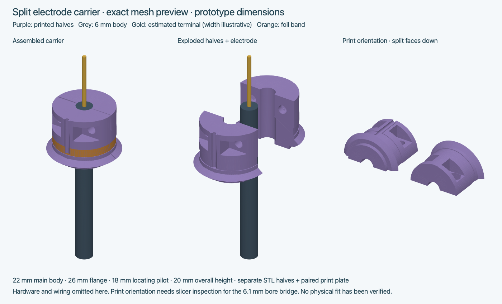
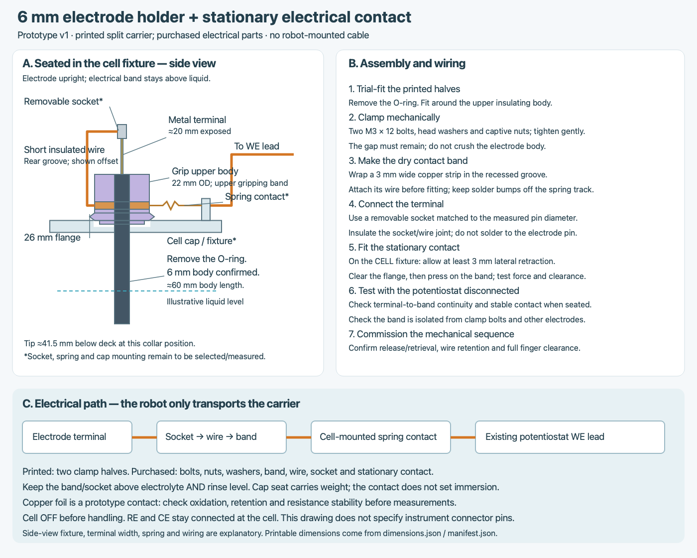

# Split carrier for the initial 6 mm electrodes

This is the new **stationary cell contact** prototype. It does not automatically replace the app's generic rack exporter or the older gripper-mounted probe concept. No lab profile, robot sequence or taught position is changed.

## Print files

- **holder_pair_print_plate.stl**: one rear + one front half, placed close together on a compact plate. Print layer-by-layer (**Cura All at Once**). This is STL geometry, not printer-specific G-code or a validated sequential-object project.
- **holder_rear.stl**, **holder_front.stl**: separate parts, same print orientations.
- **bore_fit_coupon.stl**: two short half-bore coupons. Print these first and check around the 6 mm body. This checks bore clearance, not full clamp retention.
- **dimensions.json**: editable dimensions. **manifest.json**: geometry ID, sizes, quantities, print/assembly transforms and checks.
- **electrical-assembly.png / .svg**: wiring and assembly schematic. Spring, socket and fixture mounting are explanatory, not purchased-part drawings.
- **holder-preview.png**: exact mesh geometry; terminal diameter is illustrative.

All coordinates and STL units are **mm**. Each half is oriented with its flat split face on the bed; inspect holes/channels in Cura. The 6.1 mm half-bore forms a short bridge over the bed-facing opening: inspect bridging and trial-print; finish the bore gently rather than forcing the electrode. A 0.2 mm layer height is a provisional starting point, not a validated material/process recipe. Choose material for actual electrolyte, temperature, stiffness and cleaning; keep the printed carrier dry.

## Dimensions and rack interface

| Feature | Value / evidence |
| --- | --- |
| Electrode body | **6 mm confirmed by user** |
| Body / exposed terminal length | **~60 / ~20 mm**, estimated from ruler photograph |
| Main printed body | 22 mm diameter, 20 mm total height |
| Maximum flange | 26 mm diameter, sloped upper/lower surfaces to help a compliant contact pass |
| Locating pilot | 18 mm diameter, 1.5 mm deep |
| Initial assembled bore | 6.10 mm, with 0.4 mm split gap; actual clamp fit must be tested |
| Contact groove | Z=6–9 mm above pilot bottom; 3 mm width, 0.25 mm radial recess |
| Clamp hardware | Two 3.4 mm through-holes at X=±6.3, Z=15; recessed flats and hex pockets |
| Hex pockets | 5.8 mm across flats, ~3 mm depth; verify actual nuts |
| Proposed collar position | Body top flush with collar top; tip ~41.5 mm below support deck |

The pilot matches the **nominal 18.4 mm diameter × 1.5 mm seat** of the existing default modular rack and three-electrode example. Mesh checks confirm this nominal seat does not intersect the carrier and the 6 mm rod clears the central hole. This is geometric compatibility, not a physical fit result. The larger 26 mm flange and 22 mm grip body need new finger/neighbor clearance checks; previously printed holders are not this design.

The cell cap needs the same locating counterbore (nominal 18.4 mm × 1.5 mm) and a central rod clearance hole; the existing generic cell cap is not automatically adapted. Provide an independent rigid seat so the spring does not set immersion depth.

For a differently configured rack, compare its manifest with the new pilot and flange. Do not change the app's single holder diameter to 22 and assume it describes the new pilot: this prototype has **separate pilot and main-body diameters**. Its standalone JSON is the CAD source; the UI's legacy holder exporter still makes the older holder. No automatic rack regeneration or UI profile is supplied. Teach actual tool pickup/seating Z after assembly.

## Assembly

1. Print the coupon, then one pair. Deburr and check both half-bores around the insulating body with the O-ring removed.
2. Insert two purchased M3 hex nuts into the front pockets. Trial hardware is **two M3 × 12 mm bolts, two compact M3 washers (OD ≤6 mm) under the heads, and two M3 nuts**. Check actual head, washer and nut envelope, engagement and end projection; change length if needed.
3. Fit the halves around the upper insulating body, with its top flush with the carrier top. Tighten alternately and gently. The split gap should remain; if the halves bottom together before gripping, adjust bore clearance rather than increasing force. Do not crush or mark the electrode body.
4. Confirm axial retention by hand with a dummy assembly before robot handling. The printed clamp carries the load; the terminal/socket/wire must not carry it. The sliding O-ring is not the locating stop.
5. Add the electrical band after final clamping; the band bridges the split, so remove it before disassembling the carrier.
6. Recheck tip clearance and cell cap/beaker/liquid level for the shorter electrode. The old 100 mm rod assumptions are not used for this holder.

## Prepare the electrical connection

The path is **electrode terminal → removable socket → short insulated wire → external band → cell-mounted compliant contact → potentiostat WE lead**. RE and CE stay at the cell. Instrument connector pin assignments are not specified here.

1. Cut a **3 mm wide thin copper strip** for the contact groove; about 75 mm length allows trimming and overlap. Start with approximately 0.1 mm foil thickness, accounting for adhesive if used. Groove-bottom diameter is 21.5 mm; keep the assembled band recessed and smooth.
2. Join a short flexible insulated wire to a small tab on the strip **away from the electrode and printed carrier**. Keep solder/overlap bumps off the spring track. Route the wire up the rear groove, secure it flush, and fit the band so it cannot unwrap or slip axially. Ordinary foil adhesive is not assumed conductive; make the wire-to-metal joint directly.
3. Terminate the other end in a removable socket or small screw-clamp contact **matched to the measured terminal diameter**. Do not assume a 2 mm banana socket fits. Insulate its joint and strain-relieve the wire on the carrier. Do not solder directly to the electrode terminal.
4. Mount a rounded compliant contact on an **insulated, stationary cell fixture**, aligned with the band centre after seating. The cap independently supports the flange. The contact tip must fit the 3 mm track; actual geometry, travel, force, ratings and bracket dimensions remain to be selected.
5. During insertion/retrieval the **26 mm flange must pass the contact**. Bare groove-to-flange radial difference is 2.25 mm; allow **at least 3 mm lateral retraction as a geometric starting allowance**, then check the actual contact's permitted travel and force. This is not an established compression setting. A short-travel stiff pogo pin cannot simply be substituted. Check for snagging, lifting or pushing the seated holder sideways before robot operation.
6. Connect the stationary contact to the existing WE lead. Keep the band, socket/wire and carrier above electrolyte and maximum rinse level. Copper is a dry prototype contact: oxidation, adhesive creep and resistance stability need monitoring. Consider a plated band after demonstrating this geometry.
7. With the potentiostat disconnected, check terminal-to-band and seated-contact continuity through repeated seating. Check isolation from clamp bolts, RE, CE and fixture metal. Confirm contact force does not loosen the holder.
8. Commission with cell off and dummy handling first. Current software releases the carrier during measurement; electrical continuity is **not sensed or verified by the app**.

The stationary contact mount is **not included as printable hardware**, since the actual cap/fixture and chosen contact dimensions are unknown. Likewise, the terminal socket is not included or specified by size. These are the remaining measured interfaces; the printed carrier can be trial-fitted now.

## Regenerate

Edit dimensions.json, then run from the repository root:

    # macOS / Linux
    QT_QPA_PLATFORM=offscreen .venv/bin/python cad/electrode-holder/generate.py
    # Windows
    .venv\Scripts\python.exe cad\electrode-holder\generate.py

This regenerates STLs, manifest, mesh preview and dimension-linked SVG/PNG schematic using existing dependencies. The preview omits bolts/wiring; the electrical drawing supplies the assembly explanation. Mesh checks do not establish printed fit, grip strength, chemical compatibility or electrical performance.
