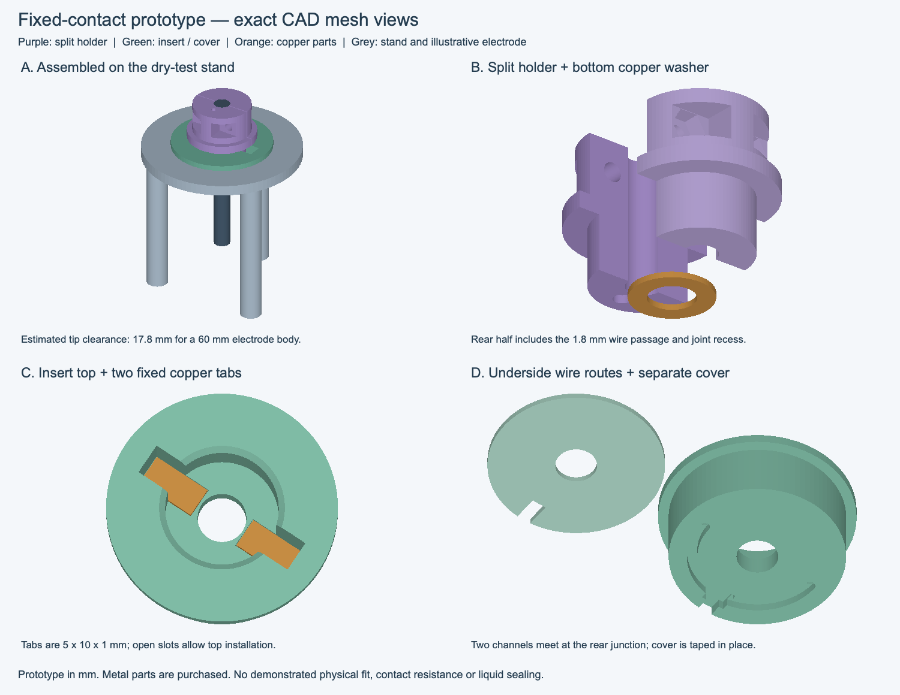
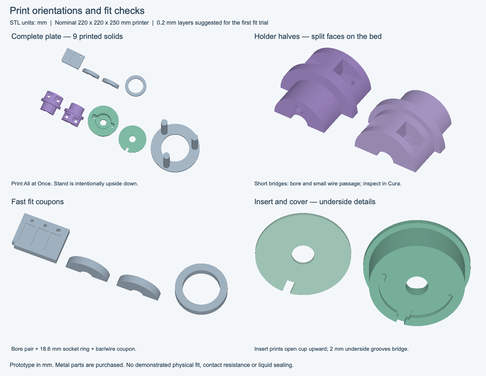

# Fixed-contact holder and insert — dry bench prototype

This is the **2026-10-14 fixed-metal-bar design** based on the user's sketches. The holder carries an underside copper ring and an internal wire passage. A removable cup-shaped insert contains two fixed copper tabs, symmetric underside wire channels and one junction for the potentiostat WE cable. A separate cover protects the wire channels. This kit includes a stand for manual dry testing; it is **not a fitted or sealed electrochemical cell cap**.



## What to print

[Download the print package](../fixed-contact-prototype-print-files.zip), containing all STLs, configuration, manifest, previews and this guide. Regeneration uses the source files in the Electrobot repository.

STL units are **mm**. Import at **100% scale**. Each individual STL is already oriented for printing and starts at Z=0.

| File | Quantity | Purpose / orientation |
| --- | --- | --- |
| `coupons_print_plate.stl` | 1 plate | Recommended first: four solids for initial fit checks |
| `complete_print_plate.stl` | 1 plate | All nine printed solids below; do not also print duplicates |
| `holder_rear.stl` | 1 | Half with the internal wire passage; flat split face down |
| `holder_front.stl` | 1 | Half with captive-nut pockets; flat split face down |
| `contact_insert.stl` | 1 | Cup open upward; fixed-bar seats and underside wire channels |
| `wire_cover.stl` | 1 | Flat underside cover; removable tape retention |
| `bench_stand.stl` | 1 | Supplied upside down: broad ring on bed, three legs upward |
| `bar_wire_coupon.stl` | 1 | Three bar-slot widths and three wire-hole sizes |
| `bore_coupon_rear.stl`, `bore_coupon_front.stl` | 1 each | Short 6.1 mm split bore; trial around a 6 mm dummy rod |
| `socket_fit_coupon.stl` | 1 | Short 18.6 mm guide socket for checking the holder's lower section |

The complete plate occupies about **204 × 91 × 60 mm**, within the nominal Ender-3 V2 220 × 220 × 250 mm volume. Use **Cura All at Once**, not sequential complete-object printing. The combined STL contains nine disconnected, individually closed solids. No printer-specific G-code is supplied.

For the first dry-fit print, PLA, a 0.4 mm nozzle, 0.2 mm layers, four walls and about 30% infill are provisional starting settings. Inspect the sliced layers before printing: the half-bores require short bridging, as do the 1.8 mm holder wire passage and 2 mm underside wire channels. The insert's cup stays upward, and the stand prints upside down to avoid supporting its top ring. Small bridges are intended to print without support, but bridging quality depends on the printer. Do not let support or brim material fill the passages. This material/process suggestion is for a dry fit trial, not electrolyte compatibility.



## Metal and electrical parts — not printed

| Part | Trial specification |
| --- | --- |
| Bottom contact ring | **One copper washer: 8 mm ID × 14 mm OD × 1 mm thick**, flat and uncoated |
| Fixed contacts | **Two copper tabs: 5 mm wide × 10 mm long × 1 mm thick**, cut from 1 mm flat copper sheet and deburred |
| Wire | Flexible insulated wire with **outside diameter ≤1.4 mm**; suitable 26 AWG hook-up wire is an option, but insulation OD must be checked |
| Clamp fasteners | Two M3 × 12 mm bolts, two M3 hex nuts, two compact M3 washers with OD ≤6 mm; verify actual engagement/projection |
| Top terminal connection | Removable socket matched to the actual electrode terminal diameter, which remains unmeasured |
| Retention | Small amounts of suitable adhesive for the ring and tabs; insulating tape for the removable cover and cable strain relief |

The washer is a commercially offered size; for example [Conex lists M8 × 14 × 1 mm copper sealing washers](https://conexcopper.com/en/products/copper-washers/din-7603-sealing-washer). That establishes a sourcing size, not qualification as an electrical contact. Do not substitute a different washer thickness without checking the seating dimensions. The copper tabs are deliberately simple cuts from sheet, not a proprietary connector. A temporary clip lead can connect the electrode terminal during a stationary manual continuity test while the proper socket is being selected.

## Nominal interfaces

- Confirmed electrode diameter: **6 mm**; printed bore: **6.1 mm** with a **0.4 mm split gap** before tightening.
- Holder: **24 mm** tall, **18 mm** lower locating section, **22 mm** upper body and **26 mm** flange. The lower section is **10 mm** tall.
- Insert: **18.6 mm** guide ID, **34 mm** outside body, **38 mm** top flange, **13.6 mm** overall height and **8 mm** electrode through-hole. These define a trial insert, not an interface measured from the user's cell cap.
- Fixed-tab slots: **5.3 × 10.3 mm**, with the tab bottoms **0.6 mm below** the 4 mm insert floor. The nominal 1 mm tabs therefore stand **0.4 mm proud** of the floor. The slots extend upward through the rim to allow top installation.
- When the 1 mm washer rests on the tabs, the holder's plastic bottom is at **Z=5.4 mm** in the insert frame and its flange clears the insert rim by **1.8 mm**. Glue thickness and actual part tolerances change this slightly.
- Holder wire passage: **1.8 mm** diameter. Ring joint relief: **3 mm** diameter × **1.5 mm** depth. Keep the solder joint within this envelope, on the upper/back face of the copper washer.
- Insert underside wire channels: **2 mm wide × 1.8 mm deep**, with two vertical tail passages. A **5 × 4 × 2.1 mm** recessed junction joins the two branches to a single outgoing WE lead. Keep the insulated splice within that pocket; the cover is not a liquid seal.
- The stand's socket is **34.4 mm**; its support surface is **60 mm** above the bench. With the estimated 60 mm electrode body flush to the holder top, nominal tip clearance is **17.8 mm**. Measure the real electrode and check clearance before placing it on the stand.

The holder has no positive axial stop on the electrode: its clamp establishes the collar position. The removable O-ring is not used as a structural stop. The new holder is not a drop-in replacement for the earlier 1.5 mm-deep rack pilot.

## Fit checks and assembly

1. **Start with coupons and a dummy rod.** With the rectangular coupon's notched corner at lower left and its three round holes along the upper edge, the bar-slot widths are **5.0 / 5.3 / 5.6 mm**, left to right. The respective wire-hole diameters are **1.6 / 1.8 / 2.0 mm**. Slot depth is 0.6 mm. Check the chosen metal stock and wire. The coupon's vertical holes do not perfectly predict the holder's horizontal printed passage; inspect that passage separately.
2. Deburr the printed parts. Feed the insulated wire through the holder before fitting an electrode. Clear a rough passage gently with an appropriate hand drill if needed, away from the electrode. The actual wire must pass freely.
3. Fit two nuts in the front half and clamp the halves around a 6 mm dummy rod, then the electrode only after fit is acceptable. Use washers under the bolt heads. Tighten gently and alternately; do not force the halves to close their gap or crush the insulating body. Check rod retention and hardware projection. Set the electrode body top flush with the holder top for the stated clearance estimate.
4. Prepare the washer-to-wire joint **off the printed parts and electrode**. Solder a small stripped-wire connection to the washer's upper face at the location of the rear-half wire passage; keep the opposite contact face flat. Feed the free wire end upward through the passage. Centre the washer on the holder bottom and retain it with a very thin adhesive layer, keeping adhesive out of the bore, joint pocket and contact face. Let it cure. The washer bridges the split; remove it before separating the halves.
5. Solder one wire to the **underside of each copper tab near its outer end**, off the plastic. The insert has tail-joint relief below these areas. Pass the two wires through the vertical tail passages and seat each tab fully in its slot. The inner contact areas must rest on the printed floor with both top surfaces at the same height. Retain tabs with small adhesive dabs at the outer slot sides, away from contact areas and wire passages; cure before testing. The tabs must remain fixed under repeated pickup.
6. Route one wire down each symmetric underside channel. Join and insulate both at the rear pocket with one outgoing WE lead. Keep the splice below the underside plane, within the pocket. Do not assume adhesive or the printed body conducts electricity. Tape the cover to the underside, align its notch with the cable exit, and add a small taped strain-relief loop so cable movement does not pull on the solder joints. Check that cover, tape and wires do not obstruct the stand socket; the tape is temporary prototype retention.
7. Insert the completed cartridge through the stand's ring until its flange rests on the ring. Confirm the stand is stable and the electrode tip has clearance. Lower the holder vertically by hand. **The copper washer must touch the bars before the upper holder flange touches the insert rim.** No forced insertion should be needed. If it rocks or sticks, inspect fit and bar height before continuing.
8. With the potentiostat disconnected, use a multimeter between the top electrode terminal and the outgoing WE lead. Compare with the shorted-meter-lead baseline. Repeat at least ten placements and check for intermittent readings during a gentle sideways disturbance. Check each branch separately before joining, or temporarily insulate one contact surface to check the other path. A continuity beep alone does not establish low, stable contact resistance.

Keep the washer, contacts and wiring dry. This is a **manual bench fit/contact prototype**; it has no continuity sensor and is not an authorisation to run robot handling or immerse the unsealed insert. Physical electrode retention, grip geometry, printed fit, contact stability and material compatibility remain to be demonstrated.

## Sources and regeneration

From the repository root:

```sh
# macOS / Linux
QT_QPA_PLATFORM=offscreen .venv/bin/python cad/fixed-contact-prototype/generate.py
# Windows
.venv\Scripts\python.exe cad\fixed-contact-prototype\generate.py
```

Edit `dimensions.json`, then regenerate all STLs, the manifest and both previews together. The generator uses `electrobot/fixed_contact_cad.py`; it does not read or change lab Settings. `manifest.json` records part quantities, print transforms, plate positions, nominal assembly relationships, bed bounds, dimensions and a source/configuration geometry ID. `holder_*` meshes use a local frame with Z=0 at the plastic bottom; the insert frame has Z=0 at its underside; the stand frame has Z=0 at its feet.

Verification covers closed connected solids, bore/wire/M3 hardware clearances, washer/tab contact area, non-interfering insertion samples, stand and cover fit, print transforms, bed bounds and invalid geometry. Run `.venv/bin/python scripts/check_project.py --unit-only` for the full unit suite; no hardware is used. Tests and mesh previews cannot establish physical or electrical performance.
