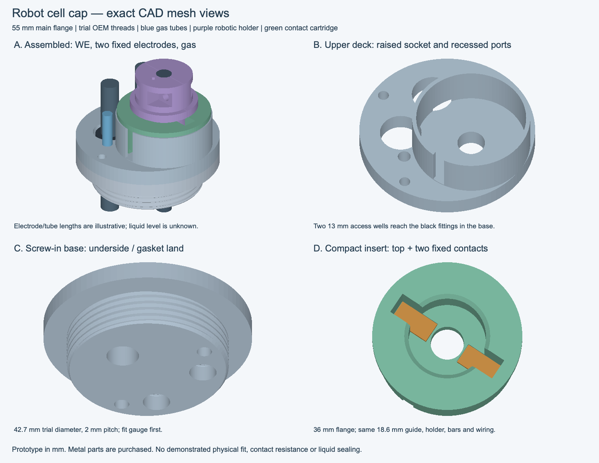
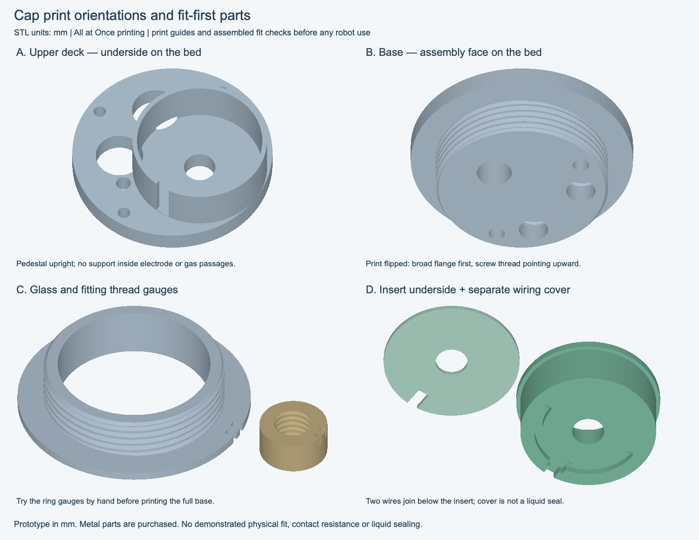
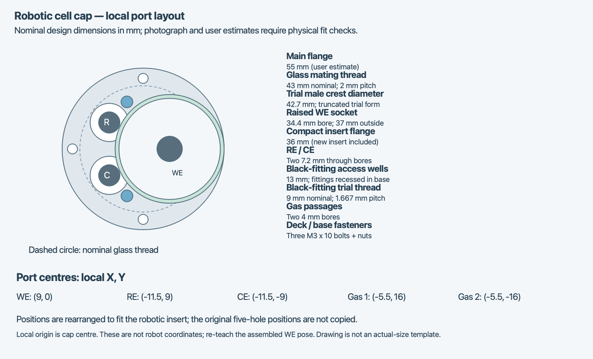

# Robotic glass-cell cap — fit-test design

Replacement cap based on the user's cell photographs and approximate dimensions. It retains **two fixed-electrode ports for RE/CE and two gas passages**, and adds a raised, removable fixed-contact cartridge for the robotic WE holder. Port positions are rearranged to fit; they do not copy the original pattern exactly.

**This is a printable fit prototype, not a verified reproduction of either OEM thread.** Print the gauges first. The 55 mm flange, 43 mm glass-thread diameter and 2 mm pitch are user estimates. The black fitting has a user-confirmed 7 mm opening; its approximately 9 mm outside thread and “six layers per centimetre” do not uniquely establish pitch or thread profile.



## Files and print order

[Download the STL package and assembly guide](../robot-cell-cap-print-files.zip). Regeneration sources are in the Electrobot repository.

| File | Print quantity | Purpose |
| --- | --- | --- |
| `gauges_print_plate.stl` | 1 plate first | Three glass-thread rings and three small-fitting thread gauges |
| `cap_assembly_print_plate.stl` | 1 plate after fit checks | Six assembly solids listed below |
| `complete_print_plate.stl` | Optional alternative | All twelve solids, including gauges; do not also print duplicate parts |
| `upper_deck.stl` | 1 | Upper plate, raised WE socket, gas bores and recessed RE/CE access wells |
| `threaded_base.stl` | 1 | Male glass thread, female RE/CE fitting threads and blind mounting-nut pockets |
| `compact_contact_insert.stl` | 1 | **36 mm flange**, otherwise the existing fixed-bar contact insert |
| `wire_cover.stl` | 1 | Removable underside wiring cover |
| `holder_rear.stl`, `holder_front.stl` | 1 each | Same split holder geometry as the earlier fixed-contact kit |

Individual STLs are already oriented with their intended print surfaces at Z=0. Print **mm, 100% scale, Cura All at Once**. The upper deck prints underside down with its socket upright; the base is supplied **flange-face down, male thread up**. Holder split faces go on the bed; insert cup opens upward. Suggested dry-fit starting settings: 0.4 mm nozzle, 0.2 mm layers, four walls and about 40% infill. Inspect the slices for thread overhangs, small passage bridges and the 5.8 mm nut-pocket ceilings. No printer-specific G-code or sequential-print clearance is supplied.

The complete plate is approximately **195 × 175 × 19.3 mm**, within the nominal Ender-3 V2 220 × 220 × 250 mm envelope. Combined STLs contain several disconnected solids; each individual part is closed and connected.



## Thread gauges — before printing the cap

The large rings have 2 mm pitch and trial major diameters **42.3, 42.7 and 43.0 mm**. Their outer flanges have **one / two / three notches**, respectively, so they remain identifiable off the bed. Start with the smallest ring and try it gently by hand on the cell, without the gasket. **Stop at binding; never force a printed thread against glass.** Check the thread pitch and form as well as diameter. The default base uses **42.7 mm**, representing 0.3 mm diametral allowance from the user's approximately 43 mm measurement.

The small gauges have a nominal **9 mm mating thread**, 0.4 mm diametral allowance and pitches **1.500, 1.667 and 2.000 mm**, marked with **one / two / three rim notches**, respectively. Try the existing black fitting in these. Six complete intervals per 10 mm would be about 1.667 mm pitch, whereas six crests spanning 10 mm would contain five intervals and imply 2 mm pitch. The default base uses **1.667 mm**, pending this check. If none fits, remeasure the outside diameter/pitch before regenerating; opening diameter is not the external thread diameter.

Both threads are **right-handed, truncated trial helical profiles**. Handedness, flank shape, engagement length and exact OEM dimensions have not been established; these are not asserted to be standard M43 or M9 threads. A fitting gauge does not establish glass loading, gasket compression or gas tightness. Adjust `dimensions.json` and regenerate the base after the actual gauge results; the upper deck can be reused if port centres and interfaces stay compatible.

## Geometry and interfaces



- Main flange **55 mm**; lower base flange **5 mm** thick; upper deck **6 mm** thick.
- Trial glass thread: **42.7 mm crest diameter, 2 mm pitch, 10 mm length**, with a 1 mm lead-in and 0.8 mm radial trial thread depth. An un-grooved annular land surrounds it for the original gasket. There is **no assumed O-ring groove or verified seal geometry**.
- RE/CE: **7.2 mm lower through-bores** for a nominal 7 mm passage, with trial female threads above. The black fittings screw into the base before the upper deck is fitted. Their heads sit in **13 mm access wells** and must be no more than **11 mm diameter × 5.5 mm height above the base top**. Those head dimensions are clearance assumptions, not measured specifications.
- Gas: two **4 mm** bores, a photo-based trial size. Actual tube outside diameter must be checked. These are plain passages, not specified compression fittings or seals.
- Raised WE socket: **34.4 mm ID, 37 mm OD**. Socket seat is **19.3 mm** above the base/deck interface. Its open side slot accepts the outgoing WE wire without requiring the wire to be threaded through a closed hole.
- Compact contact insert: **34 mm body, 36 mm flange**. Its electrode guide, copper bars, internal channels and holder interface are unchanged from the fixed-contact prototype. **Do not substitute the old 38 mm-flange insert**: it slightly overlaps the fixed-electrode body path at this compact spacing.
- The wiring cover has nominal **0.5 mm** clearance above the solid upper-deck floor. The raised position reduces direct exposure below the lid but does not seal the wiring from splashes, vapour or condensation. Keep contacts dry and keep a gas vent path open.

Coordinates below are local to the cap centre, not robot coordinates:

| Port | X (mm) | Y (mm) |
| --- | ---: | ---: |
| Robotic WE | 9.0 | 0.0 |
| Fixed electrode A (RE) | −11.5 | 9.0 |
| Fixed electrode B (CE) | −11.5 | −9.0 |
| Gas 1 | −5.5 | 16.0 |
| Gas 2 | −5.5 | −16.0 |

The two fixed ports are identical and can exchange RE/CE assignments. Their electrode bodies are modelled as no larger than 7 mm; the tube envelopes are 4 mm. The nearest nominal clearance between a fixed 7 mm electrode and the raised socket exterior is only about **0.4 mm**. Check real electrode shoulders, connectors, tilt and printing tolerances, as well as the gripper's finger envelope. Static mesh clearance does not establish robot handling clearance.

With the existing 60 mm **estimated** electrode body flush to the 24 mm holder top, the WE tip is **22.9 mm below the base/deck interface**, or **17.9 mm below the gasket land**. The male threaded plug reaches 15 mm below the interface, leaving the tip only about 7.9 mm beyond its end. Actual body length, cell interior, liquid height and intended immersion remain unknown. Check these dimensions before selecting the final cap/holder height; do not infer robot Z from this CAD model.

## Assembly

1. Use the gauge results to select the mating dimensions and regenerate. Confirm that the original gasket can sit on the new flat land without rolling, pinching or preventing thread engagement. Its cross-section/compression remains unmeasured; do not assume a seal from the drawings.
2. Place **three M3 hex nuts** in the top-side blind pockets of the base. Assemble the black RE/CE fittings to the trial female threads and check electrode retention manually. Reuse their original collet, seal or compression parts if present; matching the screw thread alone does not reproduce their gripping mechanism. No unseen internal compression feature has been inferred from the photographs. Install/adjust them before adding the upper deck; the recessed access wells limit finger access afterward.
3. Align all five passages and the three mounting holes. Join the deck to the base with **three M3 × 10 mm bolts and three compact M3 washers (OD ≤6 mm)**. The nominal nut pocket is 5.8 mm across flats × 2.6 mm deep, with a 4 mm blind shaft pocket. M3 × 10 bolts with a roughly 0.5 mm washer leave about 0.5 mm before the blind floor. Check actual hardware and do not tighten against the floor. Nothing protrudes through the gasket land.
4. Assemble the holder and contact cartridge using the [fixed-contact kit instructions](../fixed-contact-prototype/README.md): one 8 × 14 × 1 mm copper washer, two 5 × 10 × 1 mm copper tabs, flexible wire OD ≤1.4 mm, and the holder's two M3 clamp bolts/nuts/washers. Use this package's compact insert. Tape the cover lightly without increasing its diameter enough to jam the socket.
5. Seat the cartridge with its cable exit facing the socket slot. Its flange, not the wiring cover, must rest on the socket rim. Route and strain-relieve the external cable on the stationary fixture, clear of electrodes and robot fingers.
6. With a dummy rod first, check all port clearances and vertical placement/retrieval by hand. Then check the terminal-to-WE connection with the potentiostat disconnected, including repeated seating and each copper-contact branch separately.
7. Verify the real electrode tip clearance/immersion, gas venting, cap retention, material compatibility and dry electrical zone. Choose polymer for the actual electrolyte and temperature; a dry-fit PLA print is not a material qualification. This FDM prototype and its two-piece joint have not been demonstrated gas-tight or suitable for pressure service.

The source does not connect devices or change taught coordinates. Re-teach and verify the actual assembled WE pose and route before any separately authorised robot commissioning.

## Sources and regeneration

`photo-estimates.json` records the pixel landmarks and ruler estimates. The photos gave apparent outer diameters of about 61–64 mm; **the user's subsequent approximately 55 mm estimate overrides those**, illustrating the effect of parallax/different ruler and component planes. Original photographs are not copied into the public repository. No image-derived dimension is treated as a precision measurement.

From the repository root:

```sh
# macOS / Linux
QT_QPA_PLATFORM=offscreen .venv/bin/python cad/robot-cell-cap/generate.py
# Windows
.venv\Scripts\python.exe cad\robot-cell-cap\generate.py
```

`electrobot/robot_cell_cap.py` generates the cap and genuine helical trial threads. It reads this folder's configuration plus the original fixed-contact configuration, overriding only the insert flange diameter for this kit. The original kit, generic cap exporter, Settings and rack interfaces are unchanged. The manifest records source/dependency/configuration geometry IDs, print transforms, local assembly translations and clear warnings. Regeneration updates individual STLs, three plates, the manifest, exact mesh previews, port-layout SVG/PNG and the print archive together.
